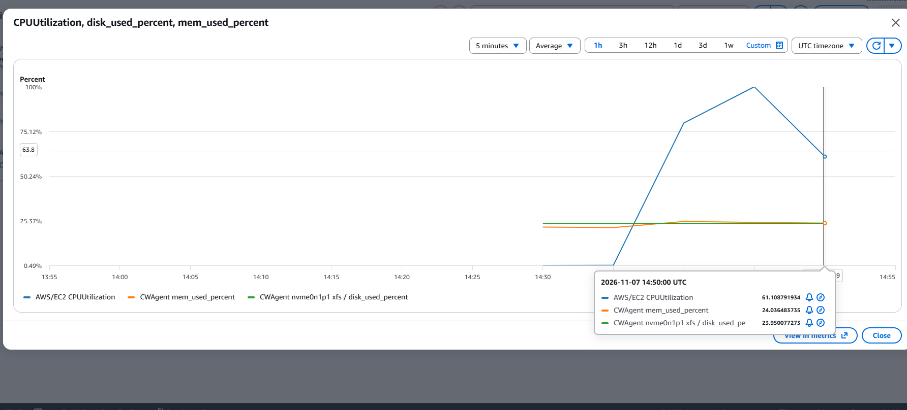
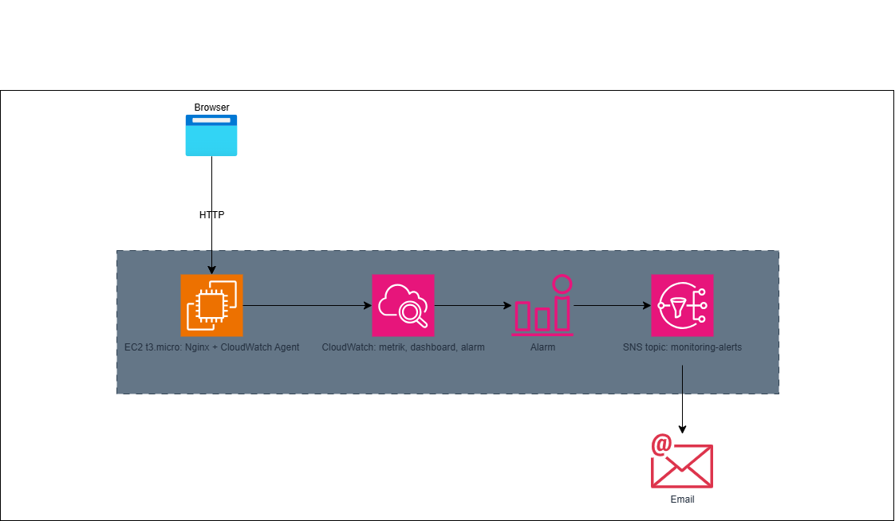
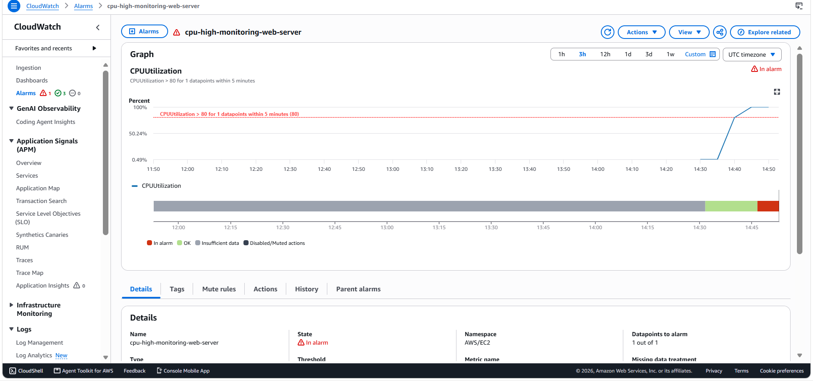
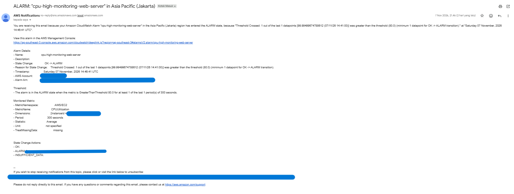

# Monitoring Server di AWS dengan CloudWatch dan SNS

Project portofolio: sebuah web server di Amazon EC2 dipantau memakai Amazon CloudWatch, dan alert dikirim otomatis ke email melalui Amazon SNS saat CPU, memory, disk, atau status server bermasalah.

Project ini memindahkan pengalaman monitoring server (Zabbix, Grafana, penanganan alert, dan dokumentasi insiden) ke lingkungan cloud AWS.

> **Catatan:** semua waktu di dokumen ini memakai UTC kecuali disebutkan lain (WIB = UTC+7).

## Hasil utama

- Server web Nginx di EC2 t3.micro (region Asia Pacific Jakarta, `ap-southeast-3`).
- Metrik memory dan disk (yang tidak tersedia secara bawaan di EC2) dikirim oleh CloudWatch Agent setiap 60 detik.
- Dashboard CloudWatch berisi CPU, memory, dan disk.
- 4 alarm yang mengirim email lewat SNS.
- Uji alert dengan beban CPU: alarm menyala dan email masuk sekitar 6 menit setelah beban dimulai.



## Arsitektur

```
Browser --HTTP--> EC2 t3.micro (Nginx + CloudWatch Agent)
                        |
                        | metrik CPU, memory, disk
                        v
                  Amazon CloudWatch (dashboard + alarm)
                        |
                        | status ALARM
                        v
                  Amazon SNS (topic: monitoring-alerts)
                        |
                        v
                      Email
```



| Komponen | Fungsi |
| --- | --- |
| EC2 t3.micro (Amazon Linux 2023) | Server web Nginx yang dipantau |
| Security group | Port 80 terbuka untuk web, port 22 (SSH) hanya dari IP pemilik |
| IAM role `monitoring-ec2-role` | Mengizinkan agent mengirim metrik ke CloudWatch tanpa menyimpan access key di server |
| CloudWatch Agent | Mengirim metrik memory dan disk |
| CloudWatch dashboard dan alarm | Menampilkan metrik dan memicu alert saat ambang terlewati |
| SNS topic `monitoring-alerts` | Mengirim email notifikasi ke alamat yang berlangganan |
| AWS Budgets | Peringatan dini jika biaya melewati batas |

## Langkah pembuatan

### 1. Pengaman akun dan biaya
- Aktifkan MFA di akun root, lalu bekerja memakai user IAM (bukan root).
- Buat AWS Budget bulanan kecil (USD 5) dengan notifikasi email.
- Aktifkan akses IAM ke halaman Billing (dilakukan sekali lewat akun root) dan alert Free Tier.

### 2. Server web
- Luncurkan EC2 `t3.micro` dengan Amazon Linux 2023 di region Jakarta.
- Security group: SSH (22) hanya dari IP sendiri, HTTP (80) dari mana saja.
- Masuk lewat SSH dan pasang Nginx:

```bash
sudo dnf install -y nginx
sudo systemctl enable --now nginx
```

### 3. IAM role untuk CloudWatch Agent
- Buat role dengan trusted entity EC2 dan policy `CloudWatchAgentServerPolicy`, lalu pasang ke instance.

### 4. CloudWatch Agent
Pasang agent:

```bash
sudo dnf install -y amazon-cloudwatch-agent
```

Konfigurasi `/opt/aws/amazon-cloudwatch-agent/etc/amazon-cloudwatch-agent.json` (lihat juga `config/amazon-cloudwatch-agent.json`):

```json
{
  "agent": { "metrics_collection_interval": 60 },
  "metrics": {
    "append_dimensions": { "InstanceId": "${aws:InstanceId}" },
    "metrics_collected": {
      "mem": { "measurement": ["mem_used_percent"] },
      "disk": { "measurement": ["used_percent"], "resources": ["/"] }
    }
  }
}
```

Nyalakan agent:

```bash
sudo /opt/aws/amazon-cloudwatch-agent/bin/amazon-cloudwatch-agent-ctl \
  -a fetch-config -m ec2 \
  -c file:/opt/aws/amazon-cloudwatch-agent/etc/amazon-cloudwatch-agent.json -s
sudo systemctl status amazon-cloudwatch-agent --no-pager
```

Metrik muncul di CloudWatch pada namespace `CWAgent` sebagai `mem_used_percent` dan `disk_used_percent`.

### 5. Dashboard
Dashboard `monitoring-web-server` berisi tiga metrik persen: `CPUUtilization`, `mem_used_percent`, dan `disk_used_percent`.

### 6. SNS dan alarm
- Buat topic SNS `monitoring-alerts` (Standard) dan langganan email, lalu konfirmasi lewat email.
- Buat alarm berikut, semuanya mengirim notifikasi saat status **In alarm** ke topic `monitoring-alerts`:

| Alarm | Metrik | Statistik | Periode | Kondisi |
| --- | --- | --- | --- | --- |
| `cpu-high-monitoring-web-server` | `CPUUtilization` (AWS/EC2) | Average | 5 menit | `> 80` |
| `memory-high-monitoring-web-server` | `mem_used_percent` (CWAgent) | Average | 1 menit | `> 80` |
| `disk-high-monitoring-web-server` | `disk_used_percent` (CWAgent) | Average | 1 menit | `> 80` |
| `status-check-failed-monitoring-web-server` | `StatusCheckFailed` (AWS/EC2) | Maximum | 1 menit | `>= 1` |

Pengaturan **Missing data treatment** dibiarkan pada *Treat missing data as missing*, supaya server yang sengaja dihentikan tidak memicu email palsu.



## Uji alert

Beban CPU dibuat dengan `stress-ng` selama 12 menit:

```bash
sudo dnf install -y stress-ng
stress-ng --cpu 2 --timeout 720s
```

Hasil:

| Waktu (UTC) | Kejadian |
| --- | --- |
| sekitar 14:40 | Beban CPU dimulai |
| 14:45 | CPU mencapai 99,99% (memory sekitar 24% dan disk sekitar 24% tidak berubah) |
| 14:46:41 | Alarm `cpu-high-monitoring-web-server` berubah dari OK ke ALARM |
| sesaat kemudian | Email alert dari AWS masuk |

Alarm memory, disk, dan status check tetap **OK**, sesuai harapan karena beban hanya menaikkan CPU. Setelah beban berhenti, alarm CPU kembali ke **OK**.



> Informasi sensitif (ID akun, alamat email, ID instance, IP publik) pada screenshot sudah disamarkan.

## Biaya

Perkiraan dengan server menyala terus (Jakarta): EC2 t3.micro sekitar USD 9,6 per bulan, disk EBS 8 GiB sekitar USD 1, IPv4 publik sekitar USD 3,6; CloudWatch dan SNS pada skala ini sekitar USD 0 (di bawah batas gratis). Dengan server dihentikan saat tidak dipakai, biayanya sekitar USD 3 per bulan.

Biaya aktual project ini: **USD 0,53**.

Pengaman biaya yang dipakai: akun Free Plan (biaya memotong kredit), AWS Budget USD 5, server dihentikan setiap selesai bekerja, dan semua resource di satu region.

## Keamanan

- MFA di akun root dan user IAM; pekerjaan harian memakai user IAM.
- SSH hanya dari satu IP, bukan dari seluruh internet.
- Server memakai IAM role, tidak ada access key di dalam server.
- File key `.pem` dan kredensial tidak pernah diunggah ke repo ini.

## Kendala dan pelajaran

1. **SSH `Connection timed out` setelah server dinyalakan lagi.** Penyebab: IP internet berubah sehingga tidak cocok dengan aturan security group. Solusi: pilih ulang *My IP* pada aturan SSH. Pelajaran: IP publik instance juga berganti setiap Stop lalu Start, jadi selalu cek alamat terbaru.
2. **Alarm "memory" ternyata memantau CPU.** Kolom *Conditions* di daftar alarm menunjukkan `CPUUtilization`, padahal namanya `memory-high`. Solusi: edit metrik alarm ke `mem_used_percent`. Pelajaran: setelah membuat alarm, selalu baca kolom Conditions, bukan hanya namanya.
3. **Alarm status check memakai ambang 80.** `StatusCheckFailed` hanya bernilai 0 atau 1, jadi ambang 80 tidak akan pernah terlewati. Solusi: ubah ke `>= 1`.
4. **Halaman Billing menolak user IAM** meski punya AdministratorAccess. Solusi: aktifkan *IAM user and role access to Billing information* lewat akun root.
5. **Metrik memory dan disk tidak ada secara bawaan** di EC2, sehingga CloudWatch Agent diperlukan.
6. **Tombol *Select metric* tidak aktif saat membuat alarm** karena lebih dari satu metrik terpilih. Alarm hanya boleh memantau satu metrik.

## Pengembangan lanjutan

- Membuat ulang infrastruktur dengan CloudFormation atau Terraform.
- Menambahkan Grafana dengan CloudWatch sebagai data source.
- Menambahkan notifikasi saat alarm kembali ke OK.
- Alert dengan ringkasan otomatis memakai AI (Lambda yang mengumpulkan log lalu membuat ringkasan).
- Memantau log Nginx lewat CloudWatch Logs.

## Membersihkan resource

Setelah selesai, hapus resource agar tidak ada biaya tersisa: terminate instance EC2, hapus volume dan snapshot yang tersisa, hapus alarm, dashboard, dan topic SNS, serta lepaskan Elastic IP jika ada.

## Struktur repo

```
.
├── README.md
├── config/
│   └── amazon-cloudwatch-agent.json
└── docs/
    ├── architecture.png
    └── screenshots/
        ├── dashboard-cpu-spike.png
        ├── alarms-in-alarm.png
        └── email-alert.png
```

## Penulis

Gerson Hary Tulak, mahasiswa Teknologi Informasi dengan pengalaman monitoring server (Zabbix, Grafana) dan penanganan alert. Bersertifikat AWS Cloud Practitioner Essentials.

LinkedIn: https://www.linkedin.com/in/gerson-hary-tulak-b63651354/
